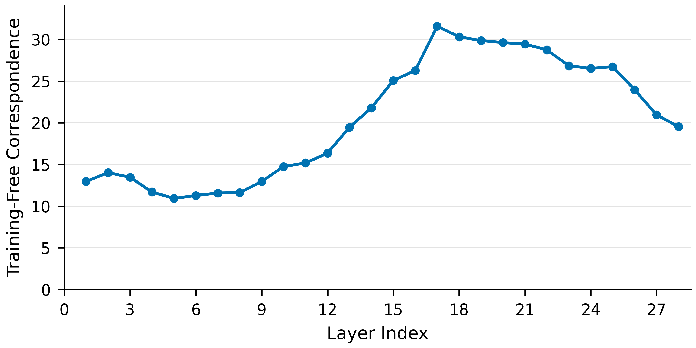
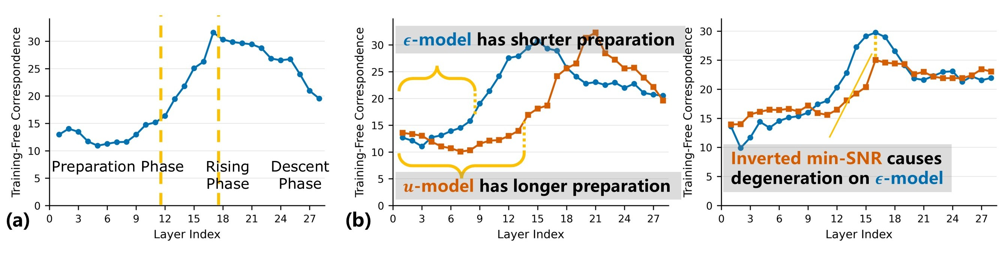

# DiT-Compare

## New findings you might be interested in...
Diffusion models contain a backbone network.
As a neutral network, its forward call generates a lot of intermediate activations.
They are in shape of $c\times h\times w$, making them compatible as dense vision features, just like DINOv2 features.
Now, if we evaluate these individual activations' performance against an identical downstream benchmarking protocol, we can obtain a curve: the x-axis is the layer index (from shallow to deep), and the y-axis is the performance, just as shown in the figure below.
This is known as the *depth profile* of diffusion backbones, and its shape is usually a inverted U: first up, then down.
Yes, this is common knowledge in the diffusion feature community.

  

So, what's *new*?  

On one hand, people used to believe this inverted U shape results from the signal granularity changing from coarse to fine as we go into deeper layers.
A certain downstream benchmarking task favors a certain granularity, and that is where the peak is.
This is a natural take in the U-Net era, since the resolution change forces such a granularity change.
But this inverted U persists in DiT models, where there's no structual bias to force granularity changes.
So, there should be a more essential mechanism that governs this depth profile.

On the other hand, the previous knowledge is restricted to a fixed model trained under a certain training recipe.
For example, DDPM + $\epsilon$-prediction + vanilla loss weighting.
But we want to know how training recipes affect the depth profile.

Both combined, the training-recipe-determining approach helps us reveal a mechanism that shapes the depth profile.  

What might you gain from this repo?
1. We provide an aligned training framework, where you can adjust sampling path, prediction target, loss weighting, and more!
All is done with the other factors fixed and aligned.
2. We reveal a detailed diffusion backbone mechanism that naturally leads to the inverted-U-shaped depth profile.
3. We provide the probing tools used in our study. This is not only for reproducing, but also for future research.

  

In case you don't have the time to check [the paper](placeholder), here's a brief overview of the mechanism findings, skipping all the evidence to support our argument.
The entire backbone can be divided into three phases:
1. **Preparation phase**. The input to the backbone is an arbitary linear combination of noise $\epsilon$ and clean image $x_0$: $x_t = \alpha(t)x_0 + \beta(t)\epsilon$. During this phase, the model extracts $x_0$ and $\epsilon$ from the mixed input signal and stores them back into subspaces of the main residual.
2. **Rising phase**. The backbone constructs a semantic, abstract, and high-level representation of the clean image. It's different from the $x_0$ signal in the input. $x_0$ is the RGB- or VAE-space image, while the representation is mainly about semantics. Just like the difference between a DINOv2 feature and the input image. We denote such a representation as $x_s$. This phase is where our new findings are the closest to the previous knowledge, probably.
3. **Descent phase**. The backbone learns from $x_s$, what it should be predicting semantically. It also learns from the (pre-stored) $x_0$ and $\epsilon$ what form the prediction should take. It combines both information and writes the prediction target into the residual. Since the prediction target also takes the form of a linear combination of $x_0$ and $\epsilon$, it somehow pollutes the $x_s$, lowering its quality/performance. This is why the depth profile goes down in this phase.

## Installation
This repo relies on another repo called [generic-diffusion-feature](https://github.com/Darkbblue/generic-diffusion-feature). Please first follow its installation instructions, and then everything's done!

## Training
For model training, check out `dit-compare/` folder.
Here's an example training command:
```bash
python3 dit-compare/train_exp.py --framework fm --target x0 --wn-mode ucenter --vae-scale 0.1 --global-batch-size 256 --num-workers 56 --data-path /path/to/imagenet/root --results-dir /path/to/checkpoints/DiT-compare --vae-path /path/to/sd-vae-ft-ema --ckpt-every 5000
```
The training script will automatically create a folder named after the argparse parameters for each different setting.
But repeated runs using the same option combination cannot be distinguished. You need to manually rename the existing folder.

OPTIONS:
- `framework` vp (DDPM) / fm (flow matching)
- `target` eps / u / x0 / a15 / a30 / a45 / a60 / a75 / a80 / a90
	- unused in paper: rotation (the linear combination recipe changes with timestep)
- `wn-mode` off / ucenter / umirror
	- unused in paper: clean / midclean / mid / midnoisy / noisy (these are multiplied with `off` instead of replacing it)
- `repa-depth` + `dinov2-ckpt`: REPA alignment layers and the DINOv2 checkpoint required for REPA training
- `repa-depth-steps` when this is set, `repa-depth` will be interpreted as a temporal sequence.
	- e.g., `--repa-depth 12 10 9 8 --repa-depth-steps 0 30 40 50` means starting at layer 12, moving to 10 after training step 30k, and so on.
- `vae-scale`: set the vae scaling factor manually, default to 0.18215, which is *biased* from Stable Diffusion's training set.
- `lsc-type` and `lsc-addon`: check our [other paper](https://github.com/Darkbblue/dit-lsc). We wanted to study how LSCs interact with different peak positions, but didn't have the time and aren't likely to have the time in the future. Feel free to give it a try yourself, and share your findings by opening an issue!
- `--data-space pixel --loss-space u --lam-sampling logit-normal --wn-mode midnoisy`: this is a long story... We've probed the raw JiT model and found that its peak position significantly skews to the right, differing from our $x_0$-model. These options are to reproduce JiT's training recipe. The conclusion is that the skewed peak position is the result of these training recipes, not $x_0$'s inherent property.  

This folder also contains two evaluation tools.  

Generation evaluation. The 2nd step uses a simple script from [DiT](https://github.com/facebookresearch/dit) repo.
```bash
python3 dit-compare/sample_exp.py --framework fm --target x0 --wn-mode ucenter --vae-scale 0.1 --ckpt /path/to/checkpoints/DiT-compare/fm-x0-vs0.1-wn-ucenter/checkpoints/0200000.pt --sample-dir /path/to/samples/fm-x0-vs0.1-wn-ucenter/200k --vae-path /path/to/sd-vae-ft-ema --num-fid-samples 10000

python3 DiT/evaluator.py /path/to/imagenet/root/VIRTUAL_imagenet256_labeled.npz /path/to/samples/fm-x0-vs0.1-wn-ucenter/200k/xxx.npz
```

Inference loss evaluation, paired with intervention functionality.
```bash
# regular run
python3 dit-compare/eval_exp.py --framework fm --target a45 --t 300 --ckpt /path/to/DiT-compare/fm-a45/checkpoints/0200000.pt --global-seed 0 --data-path /path/to/imagenet/root --vae-path /path/to/sd-vae-ft-ema --num-images 5000 --batch-size 32 --num-workers 56

# intervention run
--framework fm --target a45 --t 300 --ckpt /path/to/checkpoints/DiT-compare/fm-a45/checkpoints/0200000.pt --global-seed 0 --V /path/to/probing/dit-compare-fm-a45-t300-mlp-2.npz --V_target pipe-x0 --intervention_layers 17 18 19 20 --data-path /path/to/imagenet/root --vae-path /path/to/sd-vae-ft-ema --num-images 1000 --batch-size 32 --num-workers 56
# OPTIONS:
#	--t timestep
#	--V choose the correponding intervention codebook. This is precomputed using a certain probing script. See below.
#	--V_target: pipe-x0 or pipe-eps
#	--intervention_layers
```

We've also provided a handy tool at `t_to_snr.py` to convert t into snr values.

## Probing: Downstream task
In generic-diffusion-feature repo, you can find a script at `correspondence/task-corres-batch.py`. It will evaluate the features documented in a config file one by one rather than concatenating them together.
Use the following command to give it a try:
```bash
pytyon3 generic-diffusion-feature/correspondence/task-corres-batch.py --log_path /path/to/logs/dit/ --dataset_path /path/to/SPair-71k/JPEGImages/ --configs generic-diffusion-feature/feature/configs/dit-compare/config_dit_exp1.json --task_name exp1 --algorithm nn
```

### Whitening \& transplantation
First precompute some statistics. The example below is for whitening. If you want transplantation, also remember to set a `ref_layer`. A common practice is to set to the peak layer.
```bash
python3 generic-diffusion-feature/correspondence/task-corres-transform.py --stats_path /path/to/probing/dit-compare-fm-a60-repa-corres-transform.npz --mode collect --transform white-1 --log_path /path/to/logs/dit --dataset_path /path/to/SPair-71k/JPEGImages/ --configs generic-diffusion-feature/feature/configs/dit-compare/config_dit_exp1.json --task_name exp1 --algorithm nn
# OPTIONS: transform
#	there're many options. check task-corres-transform.py for details.
```

Then change `--mode` to `apply` and run again.

### Projection correspondence
```bash
python3 generic-diffusion-feature/correspondence/task-corres-projection-prepare.py --base_path /path/to/probing/dit-compare-vp-eps-corres.npz --log_path /path/to/logs/dit_feature/dit/ --dataset_path /path/to/SPair-71k/JPEGImages/ --configs generic-diffusion-feature/feature/configs/dit-compare/config_dit_proj_base.json --task_name exp1 --algorithm nn

python3 generic-diffusion-feature/correspondence/task-corres-projection.py --proj_basis /path/to/probing/dit-compare-vp-eps-corres.npz --log_path /path/to/logs/dit_feature/dit/ --dataset_path /path/to/SPair-71k/JPEGImages/ --configs generic-diffusion-feature/feature/configs/dit-compare/config_dit_exp1.json --task_name exp1 --algorithm nn
```

### Classification \& reconstruction
These two probes are downstream benchmarking protocols that favor information of different granularity from correspondence. To run them, you need to pre-extract features. See the next section for how to do this.
```bash
python3 probing/probe_classification.py --feature_root /path/to/probing/dit-compare-vp-u-t300/ --per_input_probes linear --modules vit-block0-out vit-block1-out vit-block2-out vit-block3-out vit-block4-out vit-block5-out vit-block6-out vit-block7-out vit-block8-out vit-block9-out vit-block10-out vit-block11-out vit-block12-out vit-block13-out vit-block14-out vit-block15-out vit-block16-out vit-block17-out vit-block18-out vit-block19-out vit-block20-out vit-block21-out vit-block22-out vit-block23-out vit-block24-out vit-block25-out vit-block26-out vit-block27-out --max_images 1000 --device cuda --input_layout chw 

python3 probing/probe_reconstruction.py --feature_root /path/to/probing/dit-compare-vp-u-t300/ --per_input_probes linear --inputs vit-block0-out vit-block1-out vit-block2-out vit-block3-out vit-block4-out vit-block5-out vit-block6-out vit-block7-out vit-block8-out vit-block9-out vit-block10-out vit-block11-out vit-block12-out vit-block13-out vit-block14-out vit-block15-out vit-block16-out vit-block17-out vit-block18-out vit-block19-out vit-block20-out vit-block21-out vit-block22-out vit-block23-out vit-block24-out vit-block25-out vit-block26-out vit-block27-out --max_images 1000 --device cuda --image_dir /path/to/imagenet/probing --input_layout chw
```

## Probing: linear probing and variants
For all linear probing and variants, you need to first extract and store features.
Run this:
```bash
python3 generic-diffusion-feature/extract_feature_per_prompt.py --layer generic-diffusion-feature/feature/configs/dit-compare/config_dit_probe1.json --version "dit-compare fm-eps-vs0.218265" --img_size 256 --batch_size 1 --t 500 --input_dir "/path/toimagenet/probing/*.JPEG" --output_dir /path/to/probing/dit-compare-fm-eps-vs0.218265-t500/ --use_original_filename --sample_name_first
```

Note: features extracted from different runs can't be used together. For example, predicting `pipe-x0` extracted during run A from `vit-block10-out` extracted during run B will yield unreliable results.  

For DINOv2 features, extract with `probing/dinov2.py`.

If you want to exactly where each feature is extracted, check `generic-diffusion-feature/feature/components/dit_compare.py`.

### probing/probe_features.py
Usage 1: vanilla R2 linear probing
```bash
python3 probing/probe_features.py --feature_root /path/to/probing/dit-compare-fm-a15-t300/ --target pipe-x0 pipe-eps --per_input_probes linear --inputs vit-block0-out vit-block1-out vit-block2-out vit-block3-out vit-block4-out vit-block5-out vit-block6-out vit-block7-out vit-block8-out vit-block9-out vit-block10-out vit-block11-out vit-block12-out vit-block14-out vit-block15-out vit-block16-out vit-block17-out vit-block18-out vit-block19-out vit-block20-out vit-block21-out vit-block22-out vit-block23-out vit-block24-out vit-block25-out vit-block26-out vit-block27-out --max_images 500 --device cuda --input_layout chw
```
Usage 2: checking how much x0 / eps can be read from model input (for our VAE scaling factor 0.18215 argument). The key is `--pair_mode patch`. `vit-xxx` and `pipe-xxx` features have different width and height. If we simply use bilinear interpolation to align them, this effectively applies a smoothing operator to the features, making eps harder to read. Hence, we instead align them based on the patchify operation. 
```bash
python3 probing/probe_features.py --feature_root /path/to/probing/dit-compare-fm-eps-vs0.218265-t500/ --target pipe-x0 pipe-eps --per_input_probes linear --inputs pipe-xt vit-input vit-input-with-pos --pair_mode patch --max_images 500 --device cuda --input_layout chw
```

Usage 3: separability probe. This does two things at the same time. 1. probe the separability, printing the results into stdout. 2. precompute the `--V` codebook for intervention loss evaluation.
```bash
python3 probing/probe_features.py --feature_root /path/to/probing/dit-compare-fm-x0-t500/ --save_deletion_dirs /path/to/probing/dit-compare-tmp-mlp-2.npz --target pipe-x0 pipe-eps --deletion_protect pipe-x0 pipe-eps --per_input_probes linear --inputs vit-block0-mlp vit-block1-mlp vit-block2-mlp vit-block3-mlp vit-block4-mlp vit-block5-mlp vit-block6-mlp vit-block7-mlp vit-block8-mlp vit-block10-mlp vit-block12-mlp vit-block14-mlp vit-block16-mlp --max_images 500 --device cuda --input_layout chw --gamma_grid 1e-8
```

### probing/probe_partial_r2.py
This probes the excess predictability given a reference feature. `--xt_module` is how you set the reference feature, which commonly is the input feature after patchification.
```bash
python3 probing/probe_partial_r2.py --feature_root /path/to/probing/dit-compare-fm-eps-t300/ --target pipe-x0 pipe-x0-low pipe-x0-high --xt_module vit-input --layers vit-block0-out vit-block1-out vit-block2-out vit-block3-out vit-block4-out vit-block5-out vit-block6-out vit-block7-out vit-block8-out vit-block9-out vit-block10-out vit-block11-out vit-block12-out vit-block13-out vit-block14-out vit-block15-out vit-block16-out vit-block17-out vit-block18-out vit-block19-out vit-block20-out vit-block21-out vit-block22-out vit-block23-out vit-block24-out vit-block25-out vit-block26-out vit-block27-out vit-final-layer-after-ln vit-final-layer-after-modulate --max_images 500 --device cuda --input_layout chw
```

### probing/probe_projection.py
This first projects a feature onto a reference feature, and then only keeps the orthogonal part. `--code_target` is how you set the reference feature, which commonly is x0 and eps.
```bash
python3 probing/probe_projection.py --feature_root /path/to/probing/dit-compare-fm-a15-t300/ --targets pipe-x0 pipe-eps vit-input --code_target pipe-x0 pipe-eps --layers vit-block0-out vit-block1-out vit-block2-out vit-block3-out vit-block4-out vit-block5-out vit-block6-out vit-block7-out vit-block8-out vit-block9-out vit-block10-out vit-block11-out vit-block12-out vit-block13-out vit-block14-out vit-block15-out vit-block16-out vit-block17-out vit-block18-out vit-block19-out vit-block20-out vit-block21-out vit-block22-out vit-block23-out vit-block24-out vit-block25-out vit-block26-out vit-block27-out vit-final-layer-after-ln --max_images 500 --device cuda --input_layout chw
```

### probing/probe_geometry.py
This measures the geometry relation between features.
```bash
python3 probing/probe_geometry.py --feature_root /path/to/probing/dit-compare-fm-eps-t300/ --inputs vit-block0-out vit-block1-out vit-block2-out vit-block3-out vit-block4-out vit-block5-out vit-block6-out vit-block7-out vit-block8-out vit-block9-out vit-block10-out vit-block11-out vit-block12-out vit-block13-out vit-block14-out --refs vit-input-with-pos vit-block0-out vit-block1-out vit-block2-out vit-block3-out vit-block4-out vit-block5-out vit-block6-out vit-block7-out vit-block8-out vit-block9-out vit-block10-out vit-block11-out vit-block12-out vit-block13-out --max_images 500 --device cuda --input_layout chw
```

## Citation
When mentioning this study, please call it *DiT-Compare*.
The citation bib is still in prepration. It's weekend and arXiv volunteers don't work overtime.
